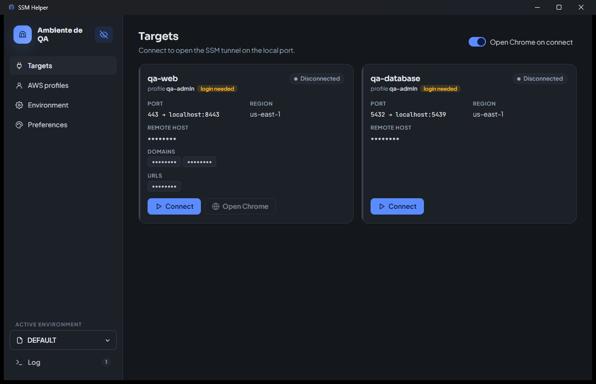
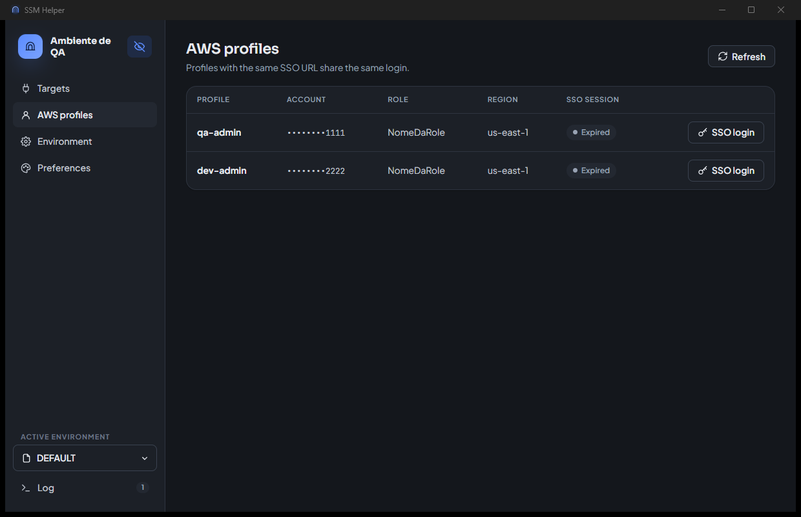
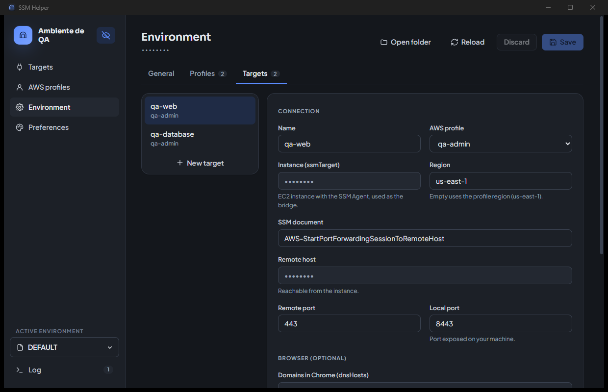
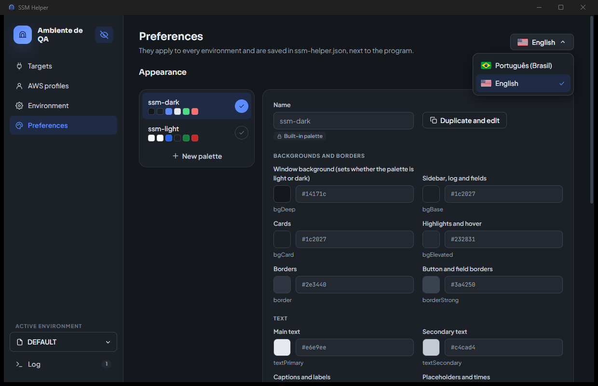

# ssm-helper

**English** · [Português](README.pt-BR.md)

Windows app that opens **AWS Systems Manager (SSM)** tunnels with **AWS SSO (IAM Identity Center)** login, through a graphical interface.

It lets you reach resources in private AWS networks (internal load balancers, RDS databases and so on) from your own machine, without a VPN and without an SSH bastion.

It is a single portable `ssm-helper.exe`: nothing to install, and no AWS CLI, Session Manager Plugin or WSL needed. All of that is built into the executable.

## Screens

Screenshots taken with privacy mode on and the sample data from `env.json.example`.

| Targets | AWS profiles |
|---|---|
|  |  |
| **Environment** | **Preferences** |
|  |  |

## Requirements

- Windows 10/11 with **WebView2** (included in Windows 11 and in up-to-date Windows 10). If it is missing, the app says so and offers the download.
- Google Chrome, for targets accessed through the browser
- Access to AWS SSO, with permission for the accounts and roles you use

No administrator rights are needed, not even for local ports below 1024 such as `443`.

## Installation

1. Download `ssm-helper.exe` from the [Releases page](https://github.com/felipeolliveira/ssm-helper/releases/latest), create a folder of your own for the app, for example `C:\Users\<you>\Tools\ssm-helper`, and put the `.exe` in it. To check the download, compare the file's SHA-256 (`Get-FileHash .\ssm-helper.exe`, in PowerShell) with the release's `SHA256SUMS.txt`.
2. Open `ssm-helper.exe`.
3. The first time, the **Environment** screen opens by itself. Add the profiles and targets and click **Save**. If you already have environment files (`env.json` or `env.<name>.json`), put them in the same folder as the `.exe` before opening it.

Everything the app uses and writes stays in the `.exe` folder (see [What lives in the app folder](#what-lives-in-the-app-folder)), so that folder must be writable. To take the app to another machine or user, copy the whole folder: environments, preferences, SSO login and Chrome profiles go along.

> Environment files hold data about your AWS accounts. They are in `.gitignore` and **must not be committed**.

## Usage

The sidebar has four screens, the environment selector and the log.

- **Targets**: one card per target of the active environment, with profile, region, ports and domains. **Connect** opens the tunnel; if the SSO session has expired, the browser login happens first. **Disconnect** closes the tunnel. Closing the app closes every tunnel.
- **AWS profiles**: account, role, region and how long the SSO session of each profile is valid. **SSO login** renews the session without opening a tunnel.
- **Environment**: edits the active environment (see [Environments](#environments)).
- **Preferences**: screen language (see [Language](#language)) and color palettes (see [Appearance](#appearance)).
- **Active environment**, above the Log: switches environment or creates a new one.
- **Log**: messages from the login, the tunnels and file conversions. Those that come from AWS are in English.

### Hiding sensitive data

The eye button, next to the title in the sidebar, turns on privacy mode, useful when sharing your screen or recording a video:

- remote hosts, domains, URLs and the folder path show as `••••••••`, always the same length, so neither the format nor the length of the value shows;
- account numbers show like at a bank, with only the last 4 digits (`••••••••6278`);
- in the environment editor, the account, SSO URL, instance, host, domains and URL fields also show `••••••••` and become read-only; to edit them, show the data again;
- the Log, error messages and the list of configuration problems are blurred, since they may quote IDs and hosts.

The choice is saved in `ssm-helper.json`. Click the eye again to show everything.

### Several tunnels at once

Each connected target takes its local port (`localPort`), and only one tunnel can use each port. To open several at once, use different ports, for example `8443` for QA and `9443` for production.

For those who use the Chrome window the app opens, the port does not show: URLs stay `https://domain`, because the Chrome mapping already points the domain to the right port (see [Accessing through the browser](#accessing-through-the-browser-with-the-original-domain)). Tools outside that Chrome window, such as curl or Postman, need `https://domain:<port>`.

### SSO login

On login, the app opens the IAM Identity Center page in the default browser and shows a code at the top of the window. Check that the page shows the same code and authorize it. If the browser does not open, use **Open login page** in the notice.

Profiles with the same `ssoUrl` share the same login, even across environments. When IAM Identity Center allows it, the session renews by itself; when it does not, the app asks for a new login.

## Environments

An environment groups the AWS profiles and targets of one context, such as QA, production or a customer. Each one is an `env.<name>.json` file in the `.exe` folder, for example `env.qa.json` and `env.prod.json`. When there is none, the app uses `env.json`. Names accept letters, numbers, `_` and `-`.

### Switching and creating environments

The **Active environment** selector, above the Log, lists the environments by file name in upper case: `env.customer-qa.json` shows as **CUSTOMER-QA**, and `env.json` as **DEFAULT**. It also shows how many tunnels each one has open. Switching environments **does not close the tunnels** of the others: they stay up and show as connected when you come back. You can use targets from different environments at the same time, as long as the local ports differ.

**New environment** creates an empty `env.<name>.json` or a copy of the active one. If the current environment is `env.json`, the app asks for a name for it too and renames it to `env.<name>.json`, because `env.json` is no longer used once any `env.<name>.json` exists.

The selected environment is saved in `ssm-helper.json`.

### Editing

The **Environment** screen has three tabs: **General** (title), **Profiles** and **Targets**. The app validates the fields on save and writes nothing if there is a problem. The previous version of the file is kept as `<file>.bak`. Renaming a profile also updates the targets that use it.

If you edit the file by hand, use **Reload** to read it again. Tunnels already open keep the previous settings until they are reconnected.

### Format

```json
{
  "title": "QA environment",
  "profiles": {
    "qa-admin": {
      "ssoUrl": "https://identitycenter.amazonaws.com/ssoins-0000000000000000",
      "ssoRegion": "us-east-1",
      "accountId": "111111111111",
      "roleName": "RoleName"
    }
  },
  "targets": {
    "qa-web": {
      "profile": "qa-admin",
      "ssmTarget": "i-0123456789abcdef0",
      "ssmRegion": "us-east-1",
      "ssmDocument": "AWS-StartPortForwardingSessionToRemoteHost",
      "remoteHost": "internal-my-alb-qa-0000000000.us-east-1.elb.amazonaws.com",
      "remotePort": "443",
      "localPort": "8443",
      "dnsHosts": ["qa.example.com", "api.qa.example.com"],
      "openUrls": ["qa.example.com"],
      "chromeProfile": ""
    }
  }
}
```

The full example is in `env.json.example`. The order of profiles and targets in the file is the order they appear on screen.

Regions must be AWS region names (`us-east-1`, `sa-east-1`, `us-gov-west-1`) and ports numbers from 1 to 65535. The app refuses other values because they would go into the AWS service addresses and the Chrome mapping: a region such as `evil.example.com/x` would send the SSO login to another server. Be careful with environment files received from others.

#### Root

| Field | Required | Description |
|---|---|---|
| `title` | Yes | Title shown in the sidebar |
| `profiles` | Yes | AWS profiles, by name |
| `targets` | Yes | Targets, by name |

#### `profiles`

Each key is the name of an AWS profile. Names accept only letters, numbers, `.`, `_` and `-`.

| Field | Required | Description |
|---|---|---|
| `ssoUrl` | Yes | IAM Identity Center start URL |
| `ssoRegion` | Yes | Identity Center region, such as `us-east-1`. Also the default region of the profile's targets |
| `accountId` | Yes | AWS account ID (12 digits) |
| `roleName` | Yes | Role (permission set) name in SSO |

#### `targets`

Each key is the name of a tunnel destination. Names accept only letters, numbers, `.`, `_` and `-`.

| Field | Required | Description |
|---|---|---|
| `profile` | Yes | Profile used to connect to this target. Must exist in `profiles` |
| `ssmTarget` | Yes | ID of the EC2 instance with the SSM Agent, used as the bridge |
| `ssmRegion` | No | Instance region, such as `us-east-1`. When empty, the profile's `ssoRegion` is used |
| `ssmDocument` | Yes | SSM document, usually `AWS-StartPortForwardingSessionToRemoteHost` |
| `remoteHost` | Yes | Destination host, reachable from the instance |
| `remotePort` | Yes | Port on the destination host, from 1 to 65535 |
| `localPort` | Yes | Local port exposed on your machine, from 1 to 65535 |
| `dnsHosts` | No | Domains Chrome resolves to the tunnel. Wildcards work, like `*.qa.example.com` (see [Accessing through the browser](#accessing-through-the-browser-with-the-original-domain)) |
| `openUrls` | No | URLs opened in Chrome tabs on connect. Without `http(s)://`, `https://` is used |
| `chromeProfile` | No | Chrome profile used by the target. When empty, the target name is used. Accepts only letters, numbers, `.`, `_` and `-` (see [Chrome profile](#chrome-profile)) |

## Language

The app is available in **Portuguese (Brazil)** and **English**. On first run it follows the Windows language: Portuguese when Windows is in Portuguese, English for any other language. To change it, use the flag button in the top right corner of the **Preferences** screen: it opens the list of languages, and the flag on the button changes with the choice. The change applies to every screen right away and is saved in `ssm-helper.json`.

Messages that come from AWS, such as the Session Manager Plugin lines in the Log and the details of SSO errors, stay in English, as AWS sends them.

## Appearance

The appearance applies to every environment and is stored in `ssm-helper.json`.

The app ships two built-in palettes, `ssm-dark` and `ssm-light`, which live in the code and cannot be edited or deleted. Palettes in `ssm-helper.json` are added to them. Without any choice, the app uses `ssm-dark`.

On the **Preferences** screen, the check button next to each palette makes it active. **New palette** or **Duplicate and edit** create a copy of the selected palette. Colors change on screen as you edit and are only stored on **Save**.

There is no light or dark mode to configure: a palette is light or dark according to its `bgDeep` color, which also sets the title bar theme. Missing colors come from `ssm-light` or `ssm-dark`, based on that background.

## `ssm-helper.json`

Holds the app preferences, which do not belong to an environment. The app creates and updates this file by itself; editing it by hand is only needed for adjustments the screens do not offer.

```json
{
  "activeEnv": "qa",
  "language": "en",
  "hideSensitive": false,
  "openChromeOnConnect": true,
  "appearance": {
    "palette": "teal",
    "palettes": {
      "teal": {
        "bgDeep": "#07100f",
        "primary": "#2dd4bf"
      }
    }
  }
}
```

| Field | Description |
|---|---|
| `activeEnv` | Selected environment: the `<name>` of `env.<name>.json`, or empty for `env.json` |
| `language` | Screen language: `pt-BR` or `en`. Empty follows the Windows language |
| `hideSensitive` | `true` when privacy mode (eye) is on. Default: `false` |
| `openChromeOnConnect` | The **Open Chrome on connect** switch on the Targets screen. Default: `true` |
| `appearance.palette` | Active palette: `ssm-dark`, `ssm-light` or the name of a palette in `palettes` |
| `appearance.palettes.<name>.<color>` | Color as `#rgb`, `#rrggbb` or `#rrggbbaa`. The names `ssm-dark` and `ssm-light` are reserved |

Colors used by the interface: `bgDeep`, `bgBase`, `bgCard`, `bgElevated`, `border`, `borderStrong`, `textPrimary`, `textSecondary`, `textMuted`, `textFaint`, `primary`, `primary600`, `primarySoft`, `primaryDeep`, `primaryGlow`, `success`, `warning`, `danger` and `info`.

## Accessing through the browser with the original domain

Applications must be opened by their real domain, not `localhost`, because of the TLS certificate and CORS. For that, the domain has to point to the local tunnel.

For targets with `dnsHosts` or `openUrls`, the app opens a **separate Chrome instance** as soon as the tunnel is ready, with one tab per URL in `openUrls`. This can be turned off with the **Open Chrome on connect** switch on the Targets screen; the **Open Chrome** button on each card opens the window at any time while the tunnel is up. That instance:

- uses the `--host-rules` flag to map each `dnsHosts` domain to `127.0.0.1:<localPort>`, only inside it. Also include the domains the application calls behind the scenes, such as the API;
- has its own profile (`ssm-helper-data\chrome-<profile>`, in the app folder), so it does not close or change your regular Chrome. The first time, sign in to the applications inside that window.

No administrator rights or changes to the Windows `hosts` file are needed. If you can edit it, pointing the domains to `127.0.0.1` in `C:\Windows\System32\drivers\etc\hosts` is still an alternative, but then the URL needs the local port when it is not `443`.

### Chrome profile

The profile comes from the target's `chromeProfile`. When the field is empty, each target has its own profile, named after the target.

To let several targets share logins and cookies, give them the same `chromeProfile`. Chrome, however, only applies `--host-rules` when it opens a new window for that profile. If the profile window is already open for another target, new tabs open in it with the old mapping, and the second target's domains do not go through the tunnel. So only share a profile between targets you do not use at the same time, or close the window before connecting to the other one.

### "Unsupported command-line flag" warning

When it opens, that Chrome window shows a bar saying *"You are using an unsupported command-line flag: --host-rules=... Stability and security will suffer."*. This is expected, and the mapping works normally.

- Chrome shows this warning for any flag that redirects traffic. Both `--host-rules` and `--host-resolver-rules` are on that list ([bad_flags_prompt.cc](https://chromium.googlesource.com/chromium/src/+/main/chrome/browser/ui/startup/bad_flags_prompt.cc)).
- The warning only applies to that separate window. Your regular Chrome is not affected.
- You can close the bar with the **X**, but it comes back whenever the app opens the window.
- Turning the warning off requires the `CommandLineFlagSecurityWarningsEnabled` policy in the Windows registry. That hides the warning for every flag in all of Chrome and is usually blocked by IT in corporate environments, so it is not recommended.

## Credentials and data

### AWS credentials

Profiles come **only** from the active environment. The app does not read or change `~/.aws/config`, `~/.aws/credentials` or Windows `AWS_*` variables. Temporary role credentials only live in the app's memory.

### What lives in the app folder

```
ssm-helper\
  ssm-helper.exe
  env.json, env.<name>.json   environments
  ssm-helper.json             preferences: active environment, language, eye, Chrome on connect, appearance
  ssm-helper-data\
    sso-cache\                SSO login token, one file per ssoUrl
    chrome-<profile>\         Chrome profiles of the targets, with application logins and cookies
    webview\                  internal data of the app window (WebView2)
    logs\                     everything shown in the Log, one file per day (ssm-helper-YYYY-MM-DD.log)
```

The app's data lives only in this folder, nothing in `%APPDATA%` or `%LOCALAPPDATA%`. The installed Chrome and Windows itself keep their own records, as with any program.

`ssm-helper-data` holds the SSO token and the application cookies. That is why, on startup, the app restricts that folder to your Windows user (and SYSTEM), without inheriting the permissions of the folder the app is in: other accounts on the machine cannot read it, even if the app folder is shared. When that restriction cannot be applied (for example on a FAT32 USB drive or a network folder), the Log says so. Even so, treat the app folder as personal data: do not send it to anyone, since copying the folder takes the login along. To start from scratch, delete `ssm-helper-data` (the app asks for a new SSO login and the Chrome profiles start empty); to only force a new login, delete `ssm-helper-data\sso-cache`.

## Upgrading from earlier versions

On first run, the app converts the files from earlier versions it finds in the `.exe` folder:

| Before | Now |
|---|---|
| `config.json` and `config.<name>.json` (keys such as `AWS_SSO_URL`, `DNS_HOSTS`) | `env.json` and `env.<name>.json` |
| `config.yaml` and `config.<name>.yaml` (script version, through WSL) | `env.json` and `env.<name>.json` |
| `ssm-helper.settings.json` | `ssm-helper.json` |
| `appearance` section inside `config.yaml` | `appearance` in `ssm-helper.json` |
| `%LOCALAPPDATA%\ssm-helper` (SSO login and Chrome profiles) | `ssm-helper-data\`, in the app folder, starting empty |

`%LOCALAPPDATA%\ssm-helper` is not brought over: if it were, any new copy of the app would take the login and Chrome profiles from the others. On first run, sign in to SSO again and, for targets accessed through Chrome, sign in to the applications again; the Log says the old folder can be deleted. The old eye and Chrome-on-connect preferences, which lived inside the app window, are not brought over either: set them again on screen if needed. The `%APPDATA%\ssm-helper.exe` folder from earlier versions can be deleted.

Environments are only converted while there is no `env*.json` in the folder. When there are both `config.*.json` and `config.*.yaml` files, the JSON ones are used, since they are newer. Old files are not deleted, and the Log shows what was converted. After checking the environments, you can delete them.

## Troubleshooting

| Symptom | Likely cause |
|---|---|
| Windows blocks the `.exe` (SmartScreen or antivirus) | The executable is not signed. Ask IT to allow the file |
| WebView2 missing warning on startup | Windows does not have the WebView2 Runtime. Install it from the link in the warning or ask IT |
| The Environment screen opens by itself | The active environment does not exist in the `.exe` folder or has invalid fields. Fix it on screen and save |
| "The file is not valid JSON" | A comma, quote or brace is missing in a hand-edited file. Fix it and use **Reload**, or start over on screen |
| "Could not save ssm-helper.json" | The `.exe` folder is not writable. Move the app to a folder of your own |
| An environment does not show in the selector | The file must be named `env.<name>.json`, with a name of letters, numbers, `_` or `-`. `env.json` only shows when there is no `env.<name>.json` |
| "Could not verify AWS access (STS)" | You do not have access to the profile's role or account |
| The browser does not open on SSO login | Use **Open login page** in the notice at the top of the window |
| "Local port ... is already in use" | Another process, or another connected target, uses the same `localPort`. Stop it or change the port (see [Several tunnels](#several-tunnels-at-once)) |
| "Chrome was not found on this computer" | Chrome is not installed or was blocked. The command used shows in the Log |
| Chrome opens but ignores the mapping | A window with the same Chrome profile was already open (same target, or another with the same `chromeProfile`). Close that window and connect again |
| "Unsupported command-line flag" warning in Chrome | Expected with `--host-rules`. See [the warning](#unsupported-command-line-flag-warning) |

## Development

The app is written in Go with [Wails v2](https://wails.io), and the interface in React + TypeScript (`frontend/`).

| Package | Responsibility |
|---|---|
| `internal/env` | Reading, validating and writing environments, listing them and converting old files |
| `internal/settings` | `ssm-helper.json`: selected environment, language, screen options and appearance (palettes) |
| `internal/msg` | Messages to the user as codes (see [Internationalization](#internationalization)) |
| `internal/jsonfile` | Reading and writing JSON while keeping key order |
| `internal/sso` | SSO login (device authorization) and role credentials |
| `internal/tunnel` | SSM session. The [Session Manager Plugin](https://github.com/aws/session-manager-plugin) is compiled into the executable, and each tunnel runs as a child process of the `.exe` itself (`--ssm-session-plugin`), because the plugin exits the process when the session ends |
| `internal/chrome` | Opening Chrome with `--host-rules` |

`app.go` exposes the bindings used by the frontend, and `main.go` sets up the window.

Requirements: Go 1.25+, Node 20+ and the Wails CLI (`go install github.com/wailsapp/wails/v2/cmd/wails@v2.17.0`).

```sh
make test   # go vet, go test, message translations and frontend type checking
make build  # builds build/bin/ssm-helper.exe (also builds from Linux/WSL)
```

To run the `.exe` with another folder for the environments, `ssm-helper.json` and `ssm-helper-data`, set the `SSM_HELPER_DIR` variable. In WSL, for example:

```sh
SSM_HELPER_DIR="$PWD" WSLENV="SSM_HELPER_DIR/p" ./build/bin/ssm-helper.exe
```

### Releases

The `.github/workflows/release.yml` workflow builds and publishes the `.exe`:

1. Create a release with a tag shaped like `vX.Y.Z`, on the GitHub Releases page or with `gh release create v1.2.0 --title v1.2.0 --notes "..."`.
2. When the release is published, the workflow runs on a GitHub Windows machine, runs the same checks as `make test`, builds and attaches `ssm-helper.exe` and `SHA256SUMS.txt` to the release.

The version in the `.exe` properties comes from the tag (`v1.2.0` becomes `1.2.0`), so `wails.json` does not need to change for each version. The workflow can also be run by hand (**Actions → Release → Run workflow**) for an existing tag: the build is kept as a run artifact and, with **upload** checked, replaces the release files.

For now there is only a Windows build.

### Internationalization

The backend never sends text to the user. Everything it communicates (errors, tunnel states, Log lines, validation problems) is an `msg.Message`: a **code** (`TUNNEL_PORT_IN_USE`), **parameters** (`{"port": "8443"}`) and, when there is one, a raw technical **detail** such as the AWS error. Binding errors reach the frontend as that message's JSON.

The frontend translates with the dictionaries in `frontend/src/i18n/locales/`:

- `pt-BR.json` and `en.json` share the same structure: `ui` with the screen texts, by screen, and `messages` with one text per backend code. Parameters are written as `{name}`;
- `useI18n()` provides `t('targets.connect')` for screen texts and `tm(message)` for backend messages; the technical detail is appended at the end (`text: detail`), unless the text places it with `{detail}`;
- a code without a translation shows as the code itself, never blank.

**New backend message:** add the constant to `internal/msg/codes.go`, use `msg.New`, `msg.Err` or `msg.Wrap`, and add the text to `messages` in **every** JSON. `make test` fails when a code has no translation.

**New screen text:** add the key to `ui` in every JSON and use `t('screen.key')`. If a dictionary misses the key, type checking fails.

**New language:** copy `pt-BR.json` under the language code (for example `es.json`), translate the texts and register it in `frontend/src/i18n/index.tsx` (`Lang`, `dictionaries` and `LANGUAGES`), in `settings.Languages` in Go, and add its flag to `frontend/src/components/Flags.tsx` (without one, the language gets the `en-US` flag). Flags are SVG because Windows shows flag emojis only as letters.

**README screenshots:** they live in `docs/screenshots/<language>/`, taken with privacy mode on and the data from `env.json.example`.
