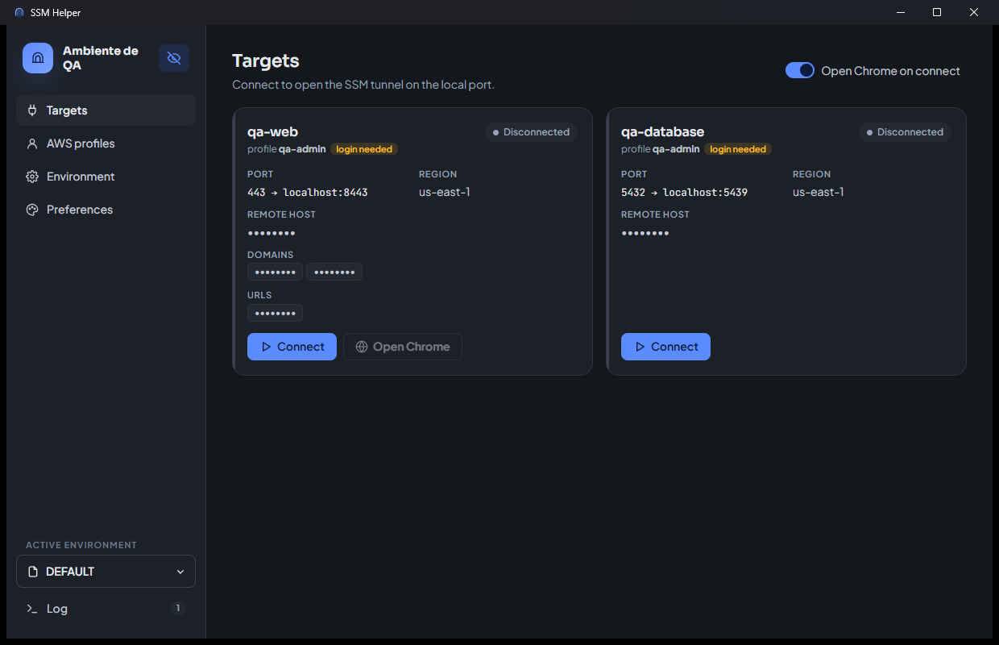
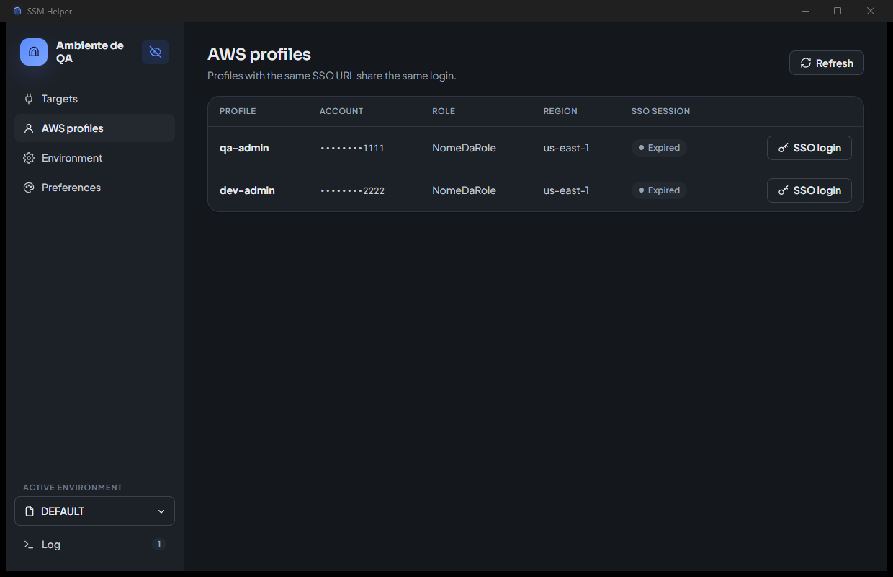
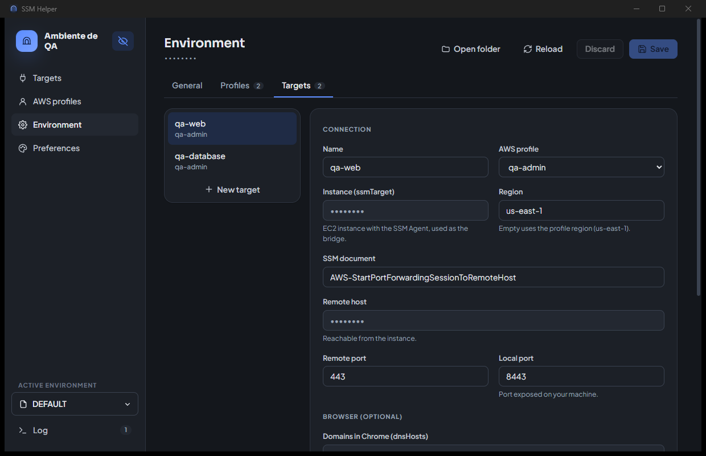
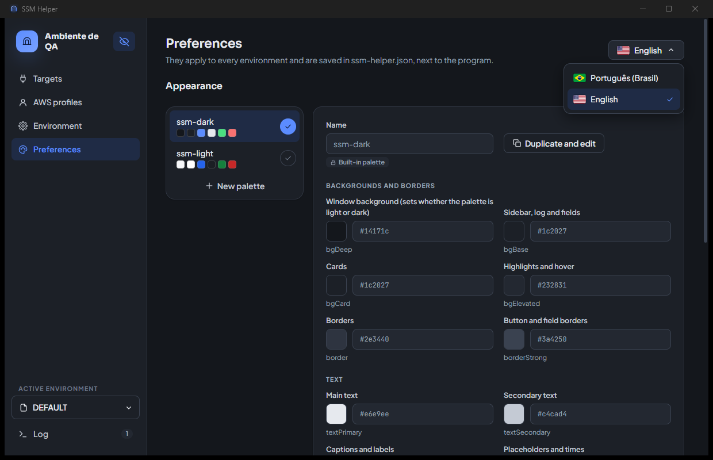

# ssm-helper

**English** · [Português](README.pt-BR.md)

Windows app that opens **AWS Systems Manager (SSM)** tunnels with **AWS SSO (IAM Identity Center)** login, through a graphical interface. It reaches resources in private AWS networks (internal load balancers, RDS databases and so on) from your machine, without a VPN or an SSH bastion.

It is a single portable `ssm-helper.exe`: no installation, AWS CLI, Session Manager Plugin or WSL needed.

## Screens

Taken with privacy mode on and the sample data from `env.json.example`.

| Targets | AWS profiles |
|---|---|
|  |  |
| **Environment** | **Preferences** |
|  |  |

## Requirements

- Windows 10/11 with **WebView2** (included in Windows 11 and up-to-date Windows 10; if missing, the app offers the download)
- Google Chrome, for targets accessed through the browser
- AWS SSO access to the accounts and roles you use

No administrator rights are needed, not even for ports below 1024 such as `443`.

## Installation

1. Download `ssm-helper.exe` from the [latest release](https://github.com/felipeolliveira/ssm-helper/releases/latest) into a folder of your own, such as `C:\Users\<you>\Tools\ssm-helper`. The folder must be writable: the app keeps everything in it.
2. Open it. The first time, the **Environment** screen opens: add the profiles and targets and click **Save**. If you already have environment files (`env.json` or `env.<name>.json`), put them next to the `.exe` first.

After that, the app updates itself (see [Updates](#updates)). To move it to another machine, copy the whole folder.

> Environment files hold data about your AWS accounts: do not commit them or send them around.

## Usage

- **Targets**: one card per target. **Connect** opens the tunnel, signing in to SSO first if the session expired. If a tunnel drops (idle timeout, network change, sleep), the app reconnects it, up to 10 attempts. Closing the app closes every tunnel.
- **AWS profiles**: account, role and SSO session of each profile. **SSO login** renews a session without opening a tunnel.
- **Environment**: edits the active environment (see [Environments](#environments)).
- **Preferences**: language and color palettes.
- **About**: version and build, **Check now** for updates, and the **Troubleshooting file**.
- **Active environment**, above the Log: switches environment or creates a new one.
- **Log**: login, tunnel and update messages, also saved to one file per day in `ssm-helper-data\logs`.

The **eye** next to the title turns on **privacy mode**, for sharing your screen: hosts, domains, URLs and paths show as `••••••••`, account numbers only show their last 4 digits, and the Log is blurred.

**SSO login**: the app opens the IAM Identity Center page in your browser and shows a code at the top of the window. Check that the page shows the same code and authorize it. Profiles with the same `ssoUrl` share the login.

**Several tunnels at once**: each target uses its own `localPort`, and only one tunnel can use each port. To open several, use different ports, such as `8443` for QA and `9443` for production. The copy button next to the port copies `localhost:<port>`, for curl, Postman or a database client.

## Environments

An environment groups the AWS profiles and targets of one context (QA, production, a customer). Each is an `env.<name>.json` file next to the `.exe`; with none, the app uses `env.json`. The selector shows them in upper case (`env.qa.json` is **QA**, `env.json` is **DEFAULT**). Switching environments does not close the tunnels of the others.

The **Environment** screen validates on save and keeps the previous file as `<file>.bak`. If you edit the file by hand, use **Reload**.

```json
{
  "title": "QA environment",
  "profiles": {
    "qa-admin": {
      "ssoUrl": "https://identitycenter.amazonaws.com/ssoins-0000000000000000",
      "ssoRegion": "us-east-1",
      "accountId": "111111111111",
      "roleName": "RoleName"
    }
  },
  "targets": {
    "qa-web": {
      "profile": "qa-admin",
      "ssmTarget": "i-0123456789abcdef0",
      "ssmRegion": "us-east-1",
      "ssmDocument": "AWS-StartPortForwardingSessionToRemoteHost",
      "remoteHost": "internal-my-alb-qa-0000000000.us-east-1.elb.amazonaws.com",
      "remotePort": "443",
      "localPort": "8443",
      "dnsHosts": ["qa.example.com", "api.qa.example.com"],
      "openUrls": ["qa.example.com"],
      "chromeProfile": ""
    }
  }
}
```

| Field | Description |
|---|---|
| `ssoUrl`, `ssoRegion` | IAM Identity Center start URL and region. The region is also the default for the profile's targets |
| `accountId`, `roleName` | AWS account (12 digits) and role (permission set) |
| `profile` | Profile the target connects with |
| `ssmTarget`, `ssmRegion` | EC2 instance with the SSM Agent used as the bridge, and its region (empty uses `ssoRegion`) |
| `ssmDocument` | Usually `AWS-StartPortForwardingSessionToRemoteHost` |
| `remoteHost`, `remotePort` | Destination, reachable from the instance |
| `localPort` | Port on your machine |
| `dnsHosts` | *Optional.* Domains Chrome sends to the tunnel; wildcards like `*.qa.example.com` work |
| `openUrls` | *Optional.* URLs opened in Chrome on connect (`https://` when no scheme is given) |
| `chromeProfile` | *Optional.* Chrome profile of the target; empty uses the target name |

Names accept letters, numbers, `.`, `_` and `-`; regions must be AWS region names and ports 1 to 65535. The full example is in `env.json.example`. Be careful with environment files received from others.

## Accessing through the browser

Applications must be opened by their real domain (TLS certificate, CORS), so the domain has to point to the tunnel. For targets with `dnsHosts` or `openUrls`, the app opens a **separate Chrome** when the tunnel is ready (turn it off with **Open Chrome on connect**). That Chrome maps each domain in `dnsHosts` to the local port with `--host-rules`, only inside it, and has its own profile in `ssm-helper-data\chrome-<profile>`, so your regular Chrome is untouched. Include the domains the application calls behind the scenes, such as the API.

- **Open Chrome** / **Close Chrome** on the card opens or closes that window, including one left open from before the app restarted.
- **⋯ → Clear browser data** closes the window and deletes that profile (cookies, localStorage, cache, logins, extensions), the same as DevTools → Clear site data. Every target with the same `chromeProfile`, in any environment, loses its data too.
- Targets with the same `chromeProfile` share logins, but Chrome only applies the mapping when it opens a new window: do not use them at the same time.
- The bar *"You are using an unsupported command-line flag: --host-rules"* is expected and only appears in that window.

## Updates

The app looks for a new version on GitHub when it opens and every 12 hours (switch on the About screen). When there is one, a bar at the top offers **What's new**, **Update and restart** and **Later**. Updating downloads the new `ssm-helper.exe`, checks it and restarts the app; connected tunnels close, so it asks first.

Updates are signed: the app only installs a version signed with the project's key. If a version cannot be verified, the bar turns into a warning: it was not installed, tell support and **do not download it by hand**. If a download fails, nothing changes and the bar offers **Download manually**.

The check only uses a proxy set in the `HTTPS_PROXY` variable, not the Windows proxy settings. On a network that requires a proxy, download new versions by hand.

## Your data

```
ssm-helper\
  ssm-helper.exe
  env.json, env.<name>.json   environments
  ssm-helper.json             preferences (environment, language, eye, palettes, update check)
  ssm-helper-data\
    sso-cache\                SSO login token
    chrome-<profile>\         Chrome profiles of the targets
    webview\                  data of the app window
    logs\                     one log file per day
```

Nothing is written to `%APPDATA%` or `%LOCALAPPDATA%`. The app does not read or change `~/.aws` or the `AWS_*` variables, and role credentials only live in memory. `ssm-helper-data` holds the SSO token and cookies, so the app restricts it to your Windows user; treat the whole folder as personal data. To start from scratch, delete `ssm-helper-data`; to only force a new SSO login, delete `ssm-helper-data\sso-cache`.

Older versions used `config.json`/`config.yaml` and `%LOCALAPPDATA%\ssm-helper`: the app converts those environments on first run and the Log says what changed. The SSO login and Chrome profiles are not brought over, so sign in again.

## Troubleshooting

To ask for help, send the **Troubleshooting file** (About screen or Log panel). It saves a `.zip` on your computer with the version, the state of tunnels and SSO sessions, the environments and the logs of the last 7 days. The app masks the account numbers, hosts, domains and URLs it recognizes, but the file is not anonymous: share it only with support and delete it afterwards. SSO tokens and cookies never go in it.

| Symptom | What to do |
|---|---|
| Windows blocks the `.exe` (SmartScreen, antivirus) | The executable is not code-signed. Ask IT to allow it |
| WebView2 missing | Install it from the link in the warning, or ask IT |
| The Environment screen opens by itself | The active environment is missing or has invalid fields. Fix it on screen and save |
| "The file is not valid JSON" | Fix the hand-edited file and use **Reload**, or start over on screen |
| "Could not save ssm-helper.json" | The folder is not writable. Move the app to a folder of your own |
| An environment does not show in the selector | Name it `env.<name>.json`. `env.json` only shows when there is no other |
| "Could not verify AWS access (STS)" | You do not have access to that account or role |
| "Local port ... is already in use" | Another program or connected target uses that `localPort`. Stop it or change the port |
| "Chrome was not found on this computer" | Install Chrome; the command used is in the Log |
| Chrome ignores the mapping | A window with the same Chrome profile was already open. Close it and connect again |
| "Could not reconnect the tunnel after 10 attempts" | The network stayed down. Connect again when it is back |
| "The tunnel dropped and the SSO session has expired" | Click **Connect** to sign in again |

## Development

See [DEVELOPMENT.md](DEVELOPMENT.md): building, code map, releases, signing and translations.
