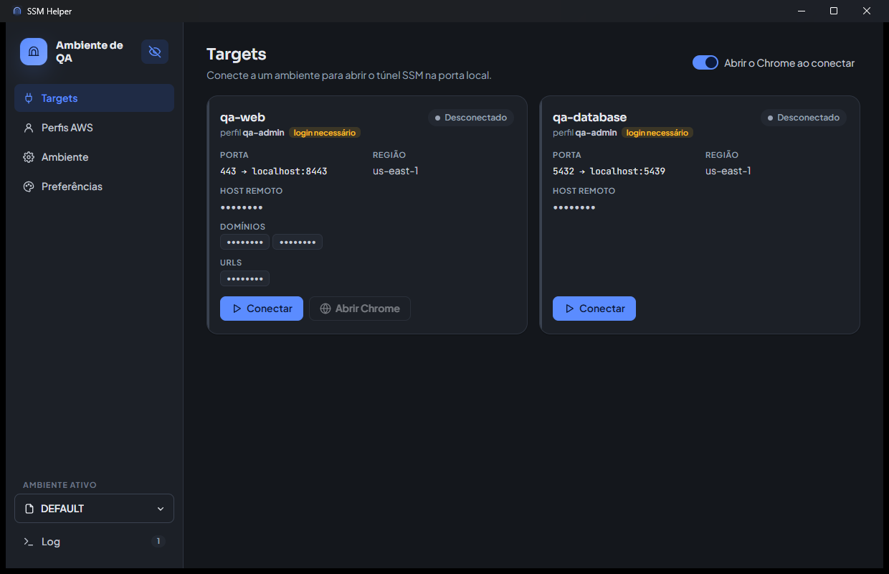
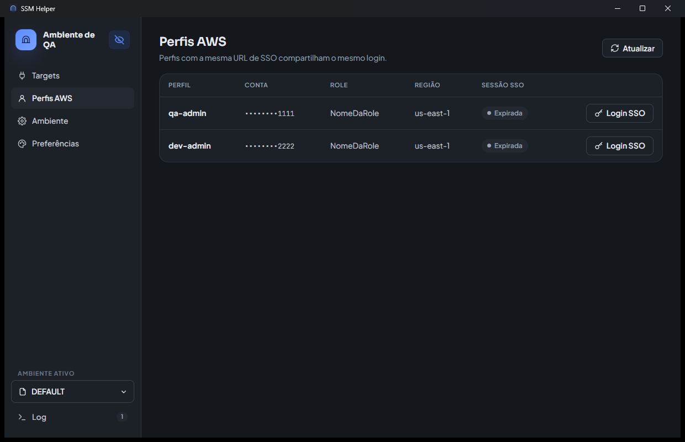
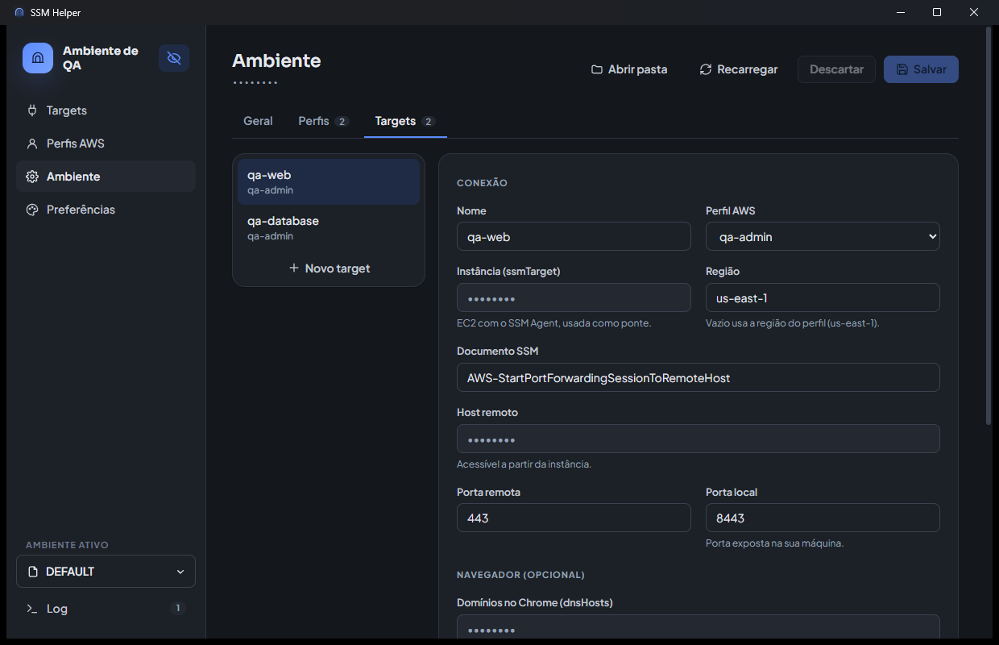
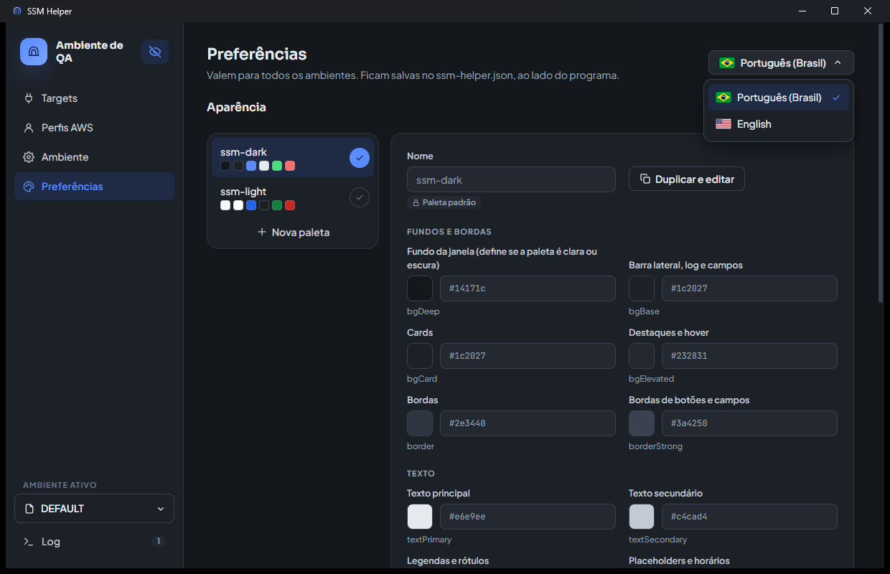

# ssm-helper

[English](README.md) · **Português**

App para Windows que abre túneis do **AWS Systems Manager (SSM)** com login pelo **AWS SSO (IAM Identity Center)**, por uma interface gráfica. Ele acessa recursos em redes privadas da AWS (load balancers internos, bancos RDS e afins) a partir da sua máquina, sem VPN nem bastion SSH.

É um único `ssm-helper.exe` portátil: não precisa instalar, nem ter AWS CLI, Session Manager Plugin ou WSL.

## Telas

Capturas com o modo de privacidade ligado e os dados de exemplo do `env.json.example`.

| Targets | Perfis AWS |
|---|---|
|  |  |
| **Ambiente** | **Preferências** |
|  |  |

## Pré-requisitos

- Windows 10/11 com **WebView2** (já vem no Windows 11 e no Windows 10 atualizado; se faltar, o app oferece o download)
- Google Chrome, para os targets acessados pelo navegador
- Acesso ao AWS SSO nas contas e roles que você usa

Não precisa de administrador, nem para portas abaixo de 1024, como a `443`.

## Instalação

1. Baixe o `ssm-helper.exe` da [última versão](https://github.com/felipeolliveira/ssm-helper/releases/latest) para uma pasta sua, como `C:\Users\<você>\Ferramentas\ssm-helper`. A pasta precisa permitir escrita: o app guarda tudo nela.
2. Abra o programa. Na primeira vez, a tela **Ambiente** abre: cadastre os perfis e targets e clique em **Salvar**. Se você já tem arquivos de ambiente (`env.json` ou `env.<nome>.json`), coloque-os ao lado do `.exe` antes.

Depois disso, o app se atualiza sozinho (veja [Atualizações](#atualizações)). Para levá-lo a outra máquina, copie a pasta inteira.

> Os arquivos de ambiente têm dados das suas contas AWS: não faça commit nem os envie por aí.

## Uso

- **Targets**: um card por target. **Conectar** abre o túnel, fazendo o login SSO antes se a sessão tiver expirado, e o card mostra há quanto tempo está conectado. Se o túnel cair (tempo ocioso, troca de rede, suspensão), o app reconecta, em até 10 tentativas. Fechar o app fecha todos os túneis.
- **Perfis AWS**: conta, role e sessão SSO de cada perfil. **Login SSO** renova a sessão sem abrir túnel.
- **Ambiente**: edita o ambiente ativo (veja [Ambientes](#ambientes)).
- **Preferências**: idioma e paletas de cores.
- **Sobre**: versão e build, **Verificar agora** para atualizações e o **Arquivo de diagnóstico**.
- **Ambiente ativo**, acima do Log: troca de ambiente ou cria um novo.
- **Log**: mensagens de login, túneis e atualizações, salvas também num arquivo por dia em `ssm-helper-data\logs`.

O **olho** ao lado do título liga o **modo de privacidade**, para compartilhar a tela: hosts, domínios, URLs e caminhos aparecem como `••••••••`, números de conta mostram só os 4 últimos dígitos e o Log fica borrado.

**Login SSO**: o app abre a página do IAM Identity Center no navegador e mostra um código no topo da janela. Confira se a página mostra o mesmo código e autorize. Perfis com o mesmo `ssoUrl` compartilham o login.

**Vários túneis ao mesmo tempo**: cada target usa a sua `localPort`, e só um túnel pode usar cada porta. Para abrir vários, use portas diferentes, como `8443` para QA e `9443` para produção.

## Ambientes

Um ambiente agrupa os perfis AWS e os targets de um contexto (QA, produção, um cliente). Cada um é um arquivo `env.<nome>.json` ao lado do `.exe`; sem nenhum, o app usa o `env.json`. O seletor mostra os nomes em maiúsculas (`env.qa.json` é **QA**, `env.json` é **DEFAULT**). Trocar de ambiente não fecha os túneis dos outros.

A tela **Ambiente** valida ao salvar e guarda o arquivo anterior como `<arquivo>.bak`. Se você editar o arquivo à mão, use **Recarregar**.

```json
{
  "title": "Ambiente de QA",
  "profiles": {
    "qa-admin": {
      "ssoUrl": "https://identitycenter.amazonaws.com/ssoins-0000000000000000",
      "ssoRegion": "us-east-1",
      "accountId": "111111111111",
      "roleName": "NomeDaRole"
    }
  },
  "targets": {
    "qa-web": {
      "profile": "qa-admin",
      "ssmTarget": "i-0123456789abcdef0",
      "ssmRegion": "us-east-1",
      "ssmDocument": "AWS-StartPortForwardingSessionToRemoteHost",
      "remoteHost": "internal-meu-alb-qa-0000000000.us-east-1.elb.amazonaws.com",
      "remotePort": "443",
      "localPort": "8443",
      "dnsHosts": ["qa.example.com", "api.qa.example.com"],
      "openUrls": ["qa.example.com"],
      "chromeProfile": ""
    }
  }
}
```

| Campo | Descrição |
|---|---|
| `ssoUrl`, `ssoRegion` | URL de início e região do IAM Identity Center. A região também é o padrão dos targets do perfil |
| `accountId`, `roleName` | Conta AWS (12 dígitos) e role (permission set) |
| `profile` | Perfil com que o target conecta |
| `ssmTarget`, `ssmRegion` | Instância EC2 com o SSM Agent usada como ponte, e a região dela (vazio usa o `ssoRegion`) |
| `ssmDocument` | Normalmente `AWS-StartPortForwardingSessionToRemoteHost` |
| `remoteHost`, `remotePort` | Destino, acessível a partir da instância |
| `localPort` | Porta na sua máquina |
| `dnsHosts` | *Opcional.* Domínios que o Chrome manda para o túnel; aceita curinga, como `*.qa.example.com` |
| `openUrls` | *Opcional.* URLs abertas no Chrome ao conectar (`https://` quando não há esquema) |
| `chromeProfile` | *Opcional.* Perfil do Chrome do target; vazio usa o nome do target |

Os nomes aceitam letras, números, `.`, `_` e `-`; as regiões precisam ser nomes de região da AWS e as portas, de 1 a 65535. O exemplo completo está no `env.json.example`. Cuidado com arquivos de ambiente recebidos de terceiros.

## Acessar pelo navegador

As aplicações precisam ser abertas pelo domínio real (certificado TLS, CORS), então o domínio precisa apontar para o túnel. Em targets com `dnsHosts` ou `openUrls`, o app abre um **Chrome separado** quando o túnel fica pronto (desligue em **Abrir o Chrome ao conectar**). Esse Chrome mapeia cada domínio de `dnsHosts` para a porta local com `--host-rules`, só dentro dele, e tem perfil próprio em `ssm-helper-data\chrome-<perfil>`, então o seu Chrome normal não é afetado. Inclua os domínios que a aplicação chama por trás, como a API.

- **Abrir Chrome** / **Fechar Chrome** no card abre ou fecha essa janela, inclusive uma que ficou aberta antes de o app reiniciar.
- **⋯ → Limpar dados do navegador** fecha a janela e apaga esse perfil (cookies, localStorage, cache, logins, extensões), o mesmo que DevTools → Clear site data. Todos os targets com o mesmo `chromeProfile`, em qualquer ambiente, também perdem os dados.
- Targets com o mesmo `chromeProfile` compartilham logins, mas o Chrome só aplica o mapeamento ao abrir uma janela nova: não os use ao mesmo tempo.
- A barra *"Você está usando uma sinalização de linha de comando não suportada: --host-rules"* é esperada e só aparece nessa janela.

## Atualizações

O app procura uma versão nova no GitHub ao abrir e a cada 12 horas (chave na tela Sobre). Quando há uma, uma faixa no topo oferece **Ver novidades**, **Atualizar e reiniciar** e **Depois**. Atualizar baixa o novo `ssm-helper.exe`, confere e reinicia o app; os túneis conectados fecham, então ele pergunta antes.

As atualizações são assinadas: o app só instala uma versão assinada com a chave do projeto. Se uma versão não puder ser verificada, a faixa vira um aviso: ela não foi instalada, avise o suporte e **não a baixe manualmente**. Se um download falhar, nada muda e a faixa oferece **Baixar manualmente**.

A verificação só usa um proxy definido na variável `HTTPS_PROXY`, não a configuração de proxy do Windows. Numa rede que exija proxy, baixe as versões novas à mão.

## Seus dados

```
ssm-helper\
  ssm-helper.exe
  env.json, env.<nome>.json   ambientes
  ssm-helper.json             preferências (ambiente, idioma, olho, paletas, verificação de atualizações)
  ssm-helper-data\
    sso-cache\                token do login SSO
    chrome-<perfil>\          perfis do Chrome dos targets
    webview\                  dados da janela do app
    logs\                     um arquivo de log por dia
```

Nada é gravado em `%APPDATA%` ou `%LOCALAPPDATA%`. O app não lê nem altera o `~/.aws` ou as variáveis `AWS_*`, e as credenciais das roles só ficam na memória. O `ssm-helper-data` tem o token do SSO e os cookies, por isso o app o restringe ao seu usuário do Windows; trate a pasta inteira como dado pessoal. Para começar do zero, apague o `ssm-helper-data`; para só forçar um novo login SSO, apague o `ssm-helper-data\sso-cache`.

Versões antigas usavam `config.json`/`config.yaml` e `%LOCALAPPDATA%\ssm-helper`: o app converte esses ambientes na primeira abertura e o Log mostra o que mudou. O login SSO e os perfis do Chrome não são trazidos, então faça login de novo.

## Solução de problemas

Para pedir ajuda, envie o **Arquivo de diagnóstico** (tela Sobre ou painel de Log). Ele salva no seu computador um `.zip` com a versão, o estado dos túneis e das sessões SSO, os ambientes e os logs dos últimos 7 dias. O app mascara os números de conta, hosts, domínios e URLs que reconhece, mas o arquivo não é anônimo: compartilhe apenas com o suporte e apague depois. Tokens do SSO e cookies nunca entram.

| Sintoma | O que fazer |
|---|---|
| O Windows bloqueia o `.exe` (SmartScreen, antivírus) | O executável não tem assinatura de código. Peça à TI para liberar |
| WebView2 ausente | Instale pelo link do aviso ou peça à TI |
| A tela Ambiente abre sozinha | O ambiente ativo não existe ou tem campos inválidos. Corrija pela tela e salve |
| "O arquivo não é um JSON válido" | Corrija o arquivo editado à mão e use **Recarregar**, ou recomece pela tela |
| "Não foi possível salvar ssm-helper.json" | A pasta não permite escrita. Mova o app para uma pasta sua |
| Um ambiente não aparece no seletor | Use o nome `env.<nome>.json`. O `env.json` só aparece quando não há outro |
| "Falha ao verificar acesso AWS (STS)" | Você não tem acesso a essa conta ou role |
| "A porta local ... já está em uso" | Outro programa ou target conectado usa essa `localPort`. Pare-o ou troque a porta |
| "Chrome não encontrado neste computador" | Instale o Chrome; o comando usado está no Log |
| O Chrome ignora o mapeamento | Já havia uma janela com o mesmo perfil do Chrome. Feche-a e conecte de novo |
| "Não foi possível reconectar o túnel depois de 10 tentativas" | A rede ficou fora. Conecte de novo quando voltar |
| "O túnel caiu e a sessão SSO expirou" | Clique em **Conectar** para fazer login de novo |

## Desenvolvimento

Veja o [DEVELOPMENT.md](DEVELOPMENT.md) (em inglês): build, mapa do código, releases, assinatura e traduções.
