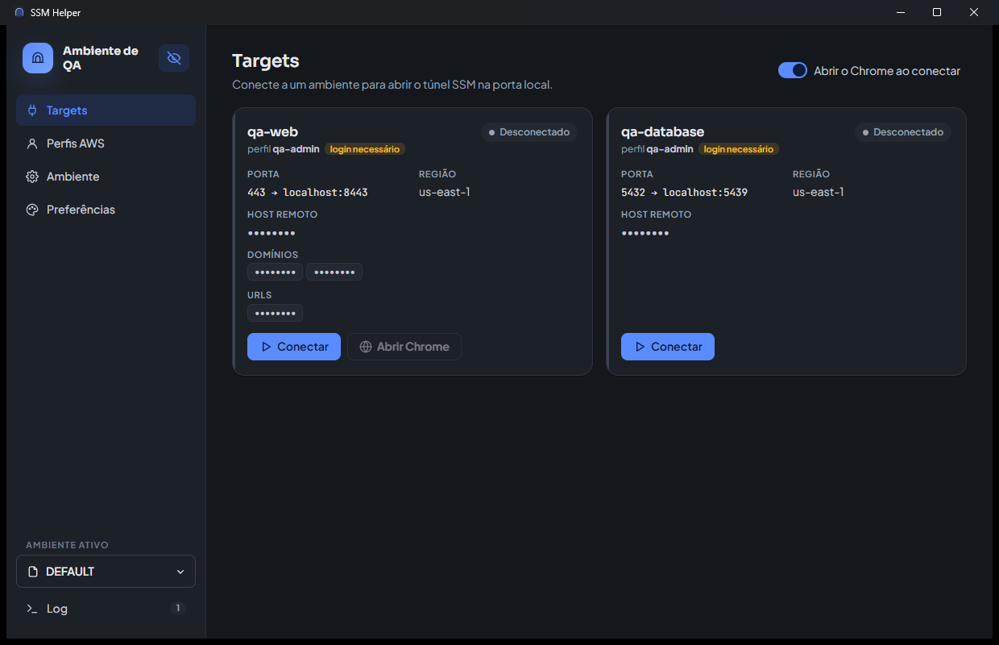
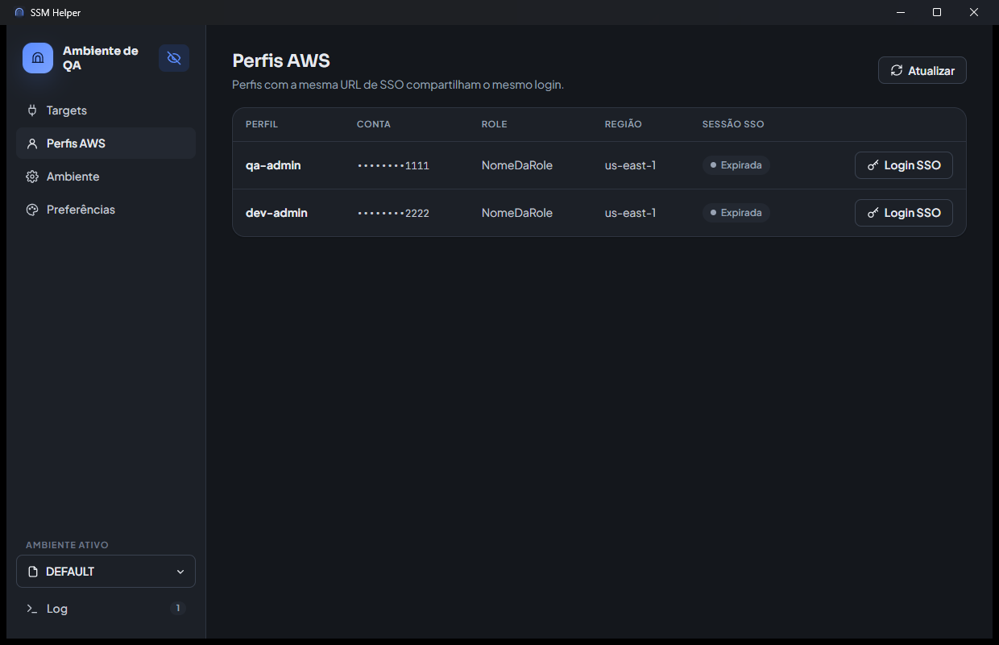
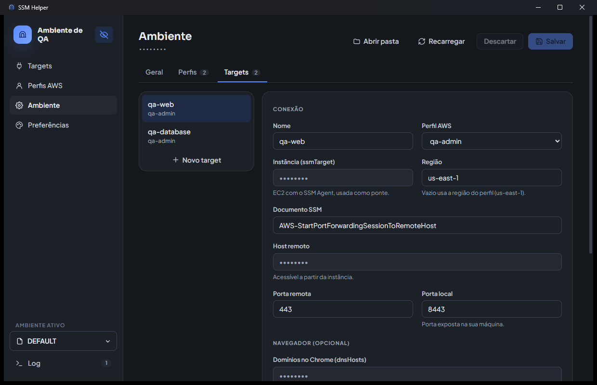
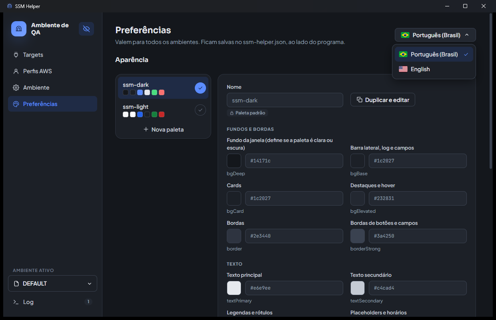

# ssm-helper

[English](README.md) · **Português**

Aplicativo para Windows que abre túneis do **AWS Systems Manager (SSM)** usando login via **AWS SSO (IAM Identity Center)**, com interface gráfica.

Com ele você acessa recursos em redes privadas da AWS (load balancers internos, bancos RDS etc.) pela sua máquina local, sem VPN e sem bastion com SSH.

É um único `ssm-helper.exe` portátil: não precisa instalar nada, nem ter AWS CLI, Session Manager Plugin ou WSL. Tudo isso já vem dentro do executável.

## Telas

Prints com o modo de privacidade ligado e os dados de exemplo do `env.json.example`.

| Targets | Perfis AWS |
|---|---|
|  |  |
| **Ambiente** | **Preferências** |
|  |  |

## Pré-requisitos

- Windows 10/11 com o **WebView2** (já vem no Windows 11 e no Windows 10 atualizado). Se faltar, o app avisa e oferece o download.
- Google Chrome, para os targets acessados pelo navegador
- Acesso ao AWS SSO, com permissão para as contas e roles usadas

Não é preciso permissão de administrador, nem para portas locais abaixo de 1024, como a `443`.

## Instalação

1. Baixe o `ssm-helper.exe` da [página de Releases](https://github.com/felipeolliveira/ssm-helper/releases/latest), crie uma pasta sua para o app, por exemplo `C:\Users\<você>\Tools\ssm-helper`, e coloque o `.exe` nela. Para conferir o download, compare o SHA-256 do arquivo (`Get-FileHash .\ssm-helper.exe`, no PowerShell) com o `SHA256SUMS.txt` da release.
2. Abra o `ssm-helper.exe`.
3. Na primeira vez, a tela **Ambiente** abre sozinha. Cadastre os perfis e os targets e clique em **Salvar**. Se já tiver arquivos de ambiente (`env.json` ou `env.<nome>.json`), coloque-os na mesma pasta do `.exe` antes de abrir.

Tudo o que o app usa e grava fica na pasta do `.exe` (veja [O que fica na pasta do app](#o-que-fica-na-pasta-do-app)), então ela precisa permitir escrita. Para levar o app para outra máquina ou outro usuário, copie a pasta inteira: os ambientes, as preferências, o login SSO e os perfis do Chrome vão junto.

> Os arquivos de ambiente têm dados das suas contas AWS. Eles estão no `.gitignore` e **não devem ser versionados**.

## Uso

A barra lateral tem quatro telas, o seletor de ambiente e o log.

- **Targets**: um card por target do ambiente ativo, com perfil, região, portas e domínios. **Conectar** abre o túnel; se a sessão SSO estiver expirada, o login é feito antes pelo navegador. **Desconectar** encerra o túnel. Fechar o app encerra todos os túneis.
- **Perfis AWS**: conta, role, região e até quando vale a sessão SSO de cada perfil. **Login SSO** renova a sessão sem abrir túnel.
- **Ambiente**: edita o ambiente ativo (veja [Ambientes](#ambientes)).
- **Preferências**: idioma das telas (veja [Idioma](#idioma)) e paletas de cores (veja [Aparência](#aparência)).
- **Ambiente ativo**, acima do Log: troca de ambiente ou cria um novo.
- **Log**: mensagens do login, dos túneis e das conversões de arquivos. As que vêm da AWS ficam em inglês.

### Ocultar dados sensíveis

O botão de olho, ao lado do título na barra lateral, liga o modo de privacidade, útil para compartilhar a tela ou gravar um vídeo:

- hosts remotos, domínios, URLs e o caminho da pasta aparecem como `••••••••`, sempre com o mesmo tamanho, para não revelar o formato nem o comprimento do valor;
- números de conta aparecem como em banco, só com os 4 últimos dígitos (`••••••••6278`);
- no editor de ambiente, os campos de conta, URL do SSO, instância, host, domínios e URLs também mostram `••••••••` e ficam só leitura; para editá-los, mostre os dados de novo;
- o Log, as mensagens de erro e a lista de problemas da configuração ficam borrados, porque podem citar IDs e hosts.

A escolha fica salva no `ssm-helper.json`. Clique de novo no olho para mostrar tudo.

### Vários túneis ao mesmo tempo

Cada target conectado ocupa a sua porta local (`localPort`), e só um túnel pode usar cada porta. Para abrir vários ao mesmo tempo, use portas diferentes, por exemplo `8443` para QA e `9443` para produção.

Para quem acessa pelo Chrome que o app abre, a porta não aparece: as URLs continuam `https://dominio`, porque o mapeamento do Chrome já aponta o domínio para a porta certa (veja [Acessar pelo navegador](#acessar-pelo-navegador-com-o-domínio-original)). Ferramentas fora desse Chrome, como curl ou Postman, precisam usar `https://dominio:<porta>`.

### Login SSO

Ao fazer login, o app abre a página do IAM Identity Center no navegador padrão e mostra um código no topo da janela. Confirme na página que o código é o mesmo e autorize. Se o navegador não abrir, use **Abrir página de login** no aviso.

Perfis com a mesma `ssoUrl` compartilham o mesmo login, mesmo em ambientes diferentes. Quando o IAM Identity Center permite, a sessão é renovada sozinha; quando não, o app pede um novo login.

## Ambientes

Um ambiente reúne os perfis AWS e os targets de um contexto, como QA, produção ou um cliente. Cada um é um arquivo `env.<nome>.json` na pasta do `.exe`, por exemplo `env.qa.json` e `env.prod.json`. Se não houver nenhum, o app usa o `env.json`. O nome aceita letras, números, `_` e `-`.

### Trocar e criar ambientes

O seletor **Ambiente ativo**, acima do Log, lista os ambientes pelo nome do arquivo em maiúsculas: `env.cliente-qa.json` aparece como **CLIENTE-QA**, e o `env.json` como **DEFAULT**. Ele também mostra quantos túneis cada um tem abertos. Trocar de ambiente **não fecha os túneis** dos outros: eles continuam ativos e aparecem conectados quando você volta. Dá para usar targets de ambientes diferentes ao mesmo tempo, desde que as portas locais sejam diferentes.

**Novo ambiente** cria um `env.<nome>.json` vazio ou como cópia do ativo. Se o ambiente atual for o `env.json`, o app pede um nome para ele também e o renomeia para `env.<nome>.json`, porque o `env.json` deixa de ser usado quando existe algum `env.<nome>.json`.

O ambiente selecionado fica salvo no `ssm-helper.json`.

### Editar

A tela **Ambiente** tem três abas: **Geral** (título), **Perfis** e **Targets**. O app valida os campos ao salvar e não grava nada se houver problema. A versão anterior do arquivo fica em `<arquivo>.bak`. Ao renomear um perfil, os targets que o usam são atualizados junto.

Se você editar o arquivo à mão, use **Recarregar** para ler de novo. Túneis já abertos continuam com as definições anteriores até serem reconectados.

### Formato

```json
{
  "title": "Ambiente de QA",
  "profiles": {
    "qa-admin": {
      "ssoUrl": "https://identitycenter.amazonaws.com/ssoins-0000000000000000",
      "ssoRegion": "us-east-1",
      "accountId": "111111111111",
      "roleName": "NomeDaRole"
    }
  },
  "targets": {
    "qa-web": {
      "profile": "qa-admin",
      "ssmTarget": "i-0123456789abcdef0",
      "ssmRegion": "us-east-1",
      "ssmDocument": "AWS-StartPortForwardingSessionToRemoteHost",
      "remoteHost": "internal-meu-alb-qa-0000000000.us-east-1.elb.amazonaws.com",
      "remotePort": "443",
      "localPort": "8443",
      "dnsHosts": ["qa.example.com", "api.qa.example.com"],
      "openUrls": ["qa.example.com"],
      "chromeProfile": ""
    }
  }
}
```

O exemplo completo está em `env.json.example`. A ordem dos perfis e targets no arquivo é a ordem em que aparecem na tela.

As regiões precisam ser nomes de região da AWS (`us-east-1`, `sa-east-1`, `us-gov-west-1`) e as portas, números de 1 a 65535. O app recusa outros valores porque eles iriam para os endereços dos serviços da AWS e para o mapeamento do Chrome: uma região como `evil.example.com/x` mandaria o login SSO para outro servidor. Cuidado com arquivos de ambiente recebidos de terceiros.

#### Raiz

| Campo | Obrigatório | Descrição |
|---|---|---|
| `title` | Sim | Título exibido na barra lateral |
| `profiles` | Sim | Perfis AWS, pelo nome |
| `targets` | Sim | Targets, pelo nome |

#### `profiles`

Cada chave é o nome de um perfil AWS. O nome aceita só letras, números, `.`, `_` e `-`.

| Campo | Obrigatório | Descrição |
|---|---|---|
| `ssoUrl` | Sim | URL de início do IAM Identity Center |
| `ssoRegion` | Sim | Região do Identity Center, como `us-east-1`. Também é a região padrão dos targets do perfil |
| `accountId` | Sim | ID da conta AWS (12 dígitos) |
| `roleName` | Sim | Nome da role (permission set) no SSO |

#### `targets`

Cada chave é o nome de um destino de túnel. O nome aceita só letras, números, `.`, `_` e `-`.

| Campo | Obrigatório | Descrição |
|---|---|---|
| `profile` | Sim | Perfil usado para conectar neste target. Deve existir em `profiles` |
| `ssmTarget` | Sim | ID da instância EC2 com o SSM Agent, usada como ponte |
| `ssmRegion` | Não | Região da instância, como `us-east-1`. Se ficar vazio, usa a `ssoRegion` do perfil |
| `ssmDocument` | Sim | Documento SSM, normalmente `AWS-StartPortForwardingSessionToRemoteHost` |
| `remoteHost` | Sim | Host de destino, acessível a partir da instância |
| `remotePort` | Sim | Porta no host de destino, de 1 a 65535 |
| `localPort` | Sim | Porta local exposta na sua máquina, de 1 a 65535 |
| `dnsHosts` | Não | Domínios que o Chrome resolve para o túnel. Aceita curinga, como `*.qa.example.com` (veja [Acessar pelo navegador](#acessar-pelo-navegador-com-o-domínio-original)) |
| `openUrls` | Não | URLs abertas em abas no Chrome ao conectar. Sem `http(s)://`, usa `https://` |
| `chromeProfile` | Não | Perfil do Chrome usado pelo target. Se ficar vazio, usa o nome do target. Aceita só letras, números, `.`, `_` e `-` (veja [Perfil do Chrome](#perfil-do-chrome)) |

## Idioma

O app está em **português (Brasil)** e **inglês**. Na primeira abertura, ele usa o idioma do Windows: português se o Windows estiver em português, inglês em qualquer outro. Para trocar, use o botão com a bandeira no canto superior direito da tela **Preferências**: ele abre a lista de idiomas, e a bandeira do botão troca junto. A mudança vale na hora para todas as telas e fica salva no `ssm-helper.json`.

As mensagens que vêm da AWS, como as linhas do Session Manager Plugin no Log e os detalhes de erros do SSO, continuam em inglês, como a AWS as envia.

## Aparência

A aparência vale para todos os ambientes e fica no `ssm-helper.json`.

O app traz duas paletas padrão, `ssm-dark` e `ssm-light`, que ficam no código e não podem ser editadas nem excluídas. As paletas do `ssm-helper.json` são adicionais. Sem nenhuma escolha, o app usa a `ssm-dark`.

Na tela **Preferências**, o botão de check ao lado de cada paleta a ativa. **Nova paleta** ou **Duplicar e editar** criam uma cópia da paleta selecionada. As cores mudam na hora enquanto você edita e só são gravadas ao **Salvar**.

Não há modo claro ou escuro para configurar: a paleta é clara ou escura conforme a sua cor `bgDeep`, que também define o tema da barra de título. Cores que faltarem vêm da `ssm-light` ou da `ssm-dark`, conforme esse fundo.

## `ssm-helper.json`

Guarda as preferências do app, que não pertencem a um ambiente. O app cria e atualiza esse arquivo sozinho; editar à mão só é necessário para ajustes que a tela não oferece.

```json
{
  "activeEnv": "qa",
  "language": "pt-BR",
  "hideSensitive": false,
  "openChromeOnConnect": true,
  "appearance": {
    "palette": "teal",
    "palettes": {
      "teal": {
        "bgDeep": "#07100f",
        "primary": "#2dd4bf"
      }
    }
  }
}
```

| Campo | Descrição |
|---|---|
| `activeEnv` | Ambiente selecionado: o `<nome>` de `env.<nome>.json`, ou vazio para `env.json` |
| `language` | Idioma das telas: `pt-BR` ou `en`. Vazio usa o idioma do Windows |
| `hideSensitive` | `true` quando o modo de privacidade (olho) está ligado. Padrão: `false` |
| `openChromeOnConnect` | Chave **Abrir o Chrome ao conectar**, da tela Targets. Padrão: `true` |
| `appearance.palette` | Paleta ativa: `ssm-dark`, `ssm-light` ou o nome de uma paleta em `palettes` |
| `appearance.palettes.<nome>.<cor>` | Cor em `#rgb`, `#rrggbb` ou `#rrggbbaa`. Os nomes `ssm-dark` e `ssm-light` são reservados |

Cores usadas pela interface: `bgDeep`, `bgBase`, `bgCard`, `bgElevated`, `border`, `borderStrong`, `textPrimary`, `textSecondary`, `textMuted`, `textFaint`, `primary`, `primary600`, `primarySoft`, `primaryDeep`, `primaryGlow`, `success`, `warning`, `danger` e `info`.

## Acessar pelo navegador com o domínio original

As aplicações precisam ser abertas pelo domínio real, e não por `localhost`, por causa do certificado TLS e de CORS. Para isso, o domínio precisa apontar para o túnel local.

Em targets com `dnsHosts` ou `openUrls`, o app abre uma **instância separada do Chrome** assim que o túnel fica pronto, com uma aba para cada URL de `openUrls`. Isso pode ser desligado na chave **Abrir o Chrome ao conectar**, na tela Targets; o botão **Abrir Chrome** de cada card abre a janela a qualquer momento enquanto o túnel estiver ativo. Essa instância:

- usa o flag `--host-rules` para mapear cada domínio de `dnsHosts` para `127.0.0.1:<localPort>`, só dentro dela. Inclua ali também os domínios que a aplicação chama por baixo, como o da API;
- tem perfil próprio (`ssm-helper-data\chrome-<perfil>`, na pasta do app), então não fecha nem altera o seu Chrome normal. Na primeira vez, faça login nas aplicações dentro dessa janela.

Não é preciso permissão de administrador nem mexer no arquivo `hosts` do Windows. Se puder editá-lo, apontar os domínios para `127.0.0.1` em `C:\Windows\System32\drivers\etc\hosts` continua sendo uma alternativa, mas aí o acesso precisa usar a porta local na URL quando ela não for `443`.

### Perfil do Chrome

O perfil vem do `chromeProfile` do target. Se o campo ficar vazio, cada target tem o próprio perfil, com o nome do target.

Para que vários targets compartilhem login e cookies, use o mesmo `chromeProfile` neles. Mas o Chrome só aplica o `--host-rules` quando abre uma janela nova daquele perfil. Se a janela do perfil já estiver aberta por outro target, as abas novas abrem nela com o mapeamento antigo, e os domínios do segundo target não vão para o túnel. Então só compartilhe o perfil entre targets que você não usa ao mesmo tempo, ou feche a janela antes de conectar no outro.

### Aviso "sinalização de linha de comando não suportada"

Ao abrir, essa janela do Chrome mostra uma barra com o aviso *"Você está usando uma sinalização de linha de comando não suportada: --host-rules=... A estabilidade e a segurança serão afetadas."*. Isso é esperado, e o mapeamento funciona normalmente.

- O Chrome mostra esse aviso para qualquer flag que redirecione tráfego. Tanto `--host-rules` quanto `--host-resolver-rules` estão nessa lista ([bad_flags_prompt.cc](https://chromium.googlesource.com/chromium/src/+/main/chrome/browser/ui/startup/bad_flags_prompt.cc)).
- O aviso vale só para essa janela separada. O seu Chrome normal não é afetado.
- Dá para fechar a barra no **X**, mas ela volta sempre que o app abrir a janela.
- Desligar o aviso exige a política `CommandLineFlagSecurityWarningsEnabled` no registro do Windows. Isso esconde o aviso para qualquer flag em todo o Chrome e costuma ser bloqueado pela TI em ambientes corporativos, então não é recomendado.

## Credenciais e dados

### Credenciais AWS

Os perfis vêm **apenas** do ambiente ativo. O app não lê nem altera `~/.aws/config`, `~/.aws/credentials` ou variáveis `AWS_*` do Windows. As credenciais temporárias da role ficam só na memória do app.

### O que fica na pasta do app

```
ssm-helper\
  ssm-helper.exe
  env.json, env.<nome>.json   ambientes
  ssm-helper.json             preferências: ambiente ativo, olho, Chrome ao conectar, aparência
  ssm-helper-data\
    sso-cache\                token do login SSO, um arquivo por ssoUrl
    chrome-<perfil>\          perfis do Chrome dos targets, com logins e cookies das aplicações
    webview\                  dados internos da janela do app (WebView2)
    logs\                     tudo o que aparece no Log, um arquivo por dia (ssm-helper-AAAA-MM-DD.log)
```

Os dados do app ficam só nessa pasta, nada em `%APPDATA%` ou `%LOCALAPPDATA%`. O Chrome instalado e o próprio Windows mantêm os registros deles, como em qualquer programa.

O `ssm-helper-data` tem o token do SSO e os cookies das aplicações. Por isso, ao abrir, o app restringe essa pasta ao seu usuário do Windows (e ao SYSTEM), sem herdar as permissões da pasta onde o app está: outras contas da máquina não conseguem lê-la, mesmo que a pasta do app seja compartilhada. Se não for possível aplicar essa restrição (por exemplo, num pendrive FAT32 ou numa pasta de rede), o Log avisa. Mesmo assim, trate a pasta do app como dado pessoal: não a envie a ninguém, já que copiar a pasta leva junto o login. Para começar do zero, apague o `ssm-helper-data` (o app pede um novo login SSO e os perfis do Chrome começam vazios); para só forçar um novo login, apague o `ssm-helper-data\sso-cache`.

## Atualizar de versões anteriores

Na primeira abertura, o app converte os arquivos das versões anteriores que encontrar na pasta do `.exe`:

| Antes | Agora |
|---|---|
| `config.json` e `config.<nome>.json` (chaves como `AWS_SSO_URL`, `DNS_HOSTS`) | `env.json` e `env.<nome>.json` |
| `config.yaml` e `config.<nome>.yaml` (versão em script, via WSL) | `env.json` e `env.<nome>.json` |
| `ssm-helper.settings.json` | `ssm-helper.json` |
| Seção `appearance` dentro do `config.yaml` | `appearance` no `ssm-helper.json` |
| `%LOCALAPPDATA%\ssm-helper` (login SSO e perfis do Chrome) | `ssm-helper-data\`, na pasta do app, começando vazio |

A pasta `%LOCALAPPDATA%\ssm-helper` não é trazida: se fosse, qualquer cópia nova do app levaria o login e os perfis do Chrome das outras. Na primeira abertura, faça login SSO de novo e, nos targets acessados pelo Chrome, entre nas aplicações outra vez; o Log avisa que a pasta antiga pode ser apagada. As preferências antigas do olho e do Chrome ao conectar, que ficavam dentro da janela do app, não são trazidas: ajuste de novo na tela, se precisar. A pasta `%APPDATA%\ssm-helper.exe`, das versões anteriores, pode ser apagada.

A conversão dos ambientes só acontece enquanto não existe nenhum `env*.json` na pasta. Se houver arquivos `config.*.json` e `config.*.yaml`, os JSON são usados, por serem mais recentes. Os arquivos antigos não são apagados, e o Log mostra o que foi convertido. Depois de conferir os ambientes, você pode apagá-los.

## Solução de problemas

| Sintoma | Causa provável |
|---|---|
| O Windows bloqueia o `.exe` (SmartScreen ou antivírus) | O executável não é assinado. Fale com a TI para liberar o arquivo |
| Aviso de WebView2 ausente ao abrir | O Windows não tem o WebView2 Runtime. Instale pelo link do aviso ou peça à TI |
| A tela Ambiente abre sozinha | O ambiente ativo não existe na pasta do `.exe` ou tem campos inválidos. Corrija pela tela e salve |
| "O arquivo não é um JSON válido" | Falta vírgula, aspas ou chave no arquivo editado à mão. Corrija e use **Recarregar**, ou recomece pela tela |
| "Não foi possível salvar ssm-helper.json" | A pasta do `.exe` não permite escrita. Mova o app para uma pasta sua |
| Um ambiente não aparece no seletor | O arquivo precisa se chamar `env.<nome>.json`, com nome de letras, números, `_` ou `-`. O `env.json` só aparece quando não há nenhum `env.<nome>.json` |
| "Falha ao verificar acesso AWS (STS)" | Você não tem acesso à role ou à conta do perfil |
| O navegador não abre no login SSO | Use **Abrir página de login** no aviso do topo da janela |
| "A porta local ... já está em uso" | Outro processo, ou outro target conectado, usa a mesma `localPort`. Encerre-o ou mude a porta (veja [Vários túneis](#vários-túneis-ao-mesmo-tempo)) |
| "Chrome não encontrado neste computador" | O Chrome não está instalado ou foi bloqueado. O comando usado aparece no Log |
| O Chrome abre, mas não respeita o mapeamento | Já havia uma janela aberta com o mesmo perfil do Chrome (do mesmo target ou de outro com o mesmo `chromeProfile`). Feche essa janela e conecte de novo |
| Aviso "sinalização de linha de comando não suportada" no Chrome | Esperado ao usar `--host-rules`. Veja [o aviso](#aviso-sinalização-de-linha-de-comando-não-suportada) |

## Desenvolvimento

O app é escrito em Go com [Wails v2](https://wails.io) e a interface em React + TypeScript (`frontend/`).

| Pacote | Responsabilidade |
|---|---|
| `internal/env` | Leitura, validação e gravação dos ambientes, lista de ambientes e conversão dos arquivos antigos |
| `internal/settings` | `ssm-helper.json`: ambiente selecionado, idioma, opções da tela e aparência (paletas) |
| `internal/msg` | Mensagens para o usuário como códigos (veja [Internacionalização](#internacionalização)) |
| `internal/jsonfile` | Leitura e gravação de JSON mantendo a ordem das chaves |
| `internal/sso` | Login SSO (device authorization) e credenciais da role |
| `internal/tunnel` | Sessão SSM. O [Session Manager Plugin](https://github.com/aws/session-manager-plugin) é compilado dentro do executável, e cada túnel roda como um processo filho do próprio `.exe` (`--ssm-session-plugin`), porque o plugin encerra o processo ao fim da sessão |
| `internal/chrome` | Abertura do Chrome com `--host-rules` |

`app.go` expõe os bindings usados pelo frontend, e `main.go` configura a janela.

Requisitos: Go 1.25+, Node 20+ e o Wails CLI (`go install github.com/wailsapp/wails/v2/cmd/wails@v2.17.0`).

```sh
make test   # go vet, go test, traduções dos códigos e checagem de tipos do frontend
make build  # gera build/bin/ssm-helper.exe (compila também a partir do Linux/WSL)
```

Para rodar o `.exe` usando outra pasta para os ambientes, o `ssm-helper.json` e o `ssm-helper-data`, defina a variável `SSM_HELPER_DIR`. No WSL, por exemplo:

```sh
SSM_HELPER_DIR="$PWD" WSLENV="SSM_HELPER_DIR/p" ./build/bin/ssm-helper.exe
```

### Releases

O workflow `.github/workflows/release.yml` compila e publica o `.exe`:

1. Crie uma release com uma tag no formato `vX.Y.Z`, pela página de Releases do GitHub ou com `gh release create v1.2.0 --title v1.2.0 --notes "..."`.
2. Ao publicar a release, o workflow roda num Windows do GitHub, faz os mesmos testes do `make test`, compila e anexa à release o `ssm-helper.exe` e o `SHA256SUMS.txt`.

A versão nas propriedades do `.exe` vem da tag (`v1.2.0` vira `1.2.0`), então não é preciso mudar o `wails.json` a cada versão. O workflow também pode ser rodado à mão (**Actions → Release → Run workflow**) para uma tag existente: o build fica como artefato da execução e, com **upload** marcado, substitui os arquivos da release.

Por enquanto só há build para Windows.

### Internacionalização

O backend nunca envia texto para o usuário. Tudo o que ele comunica (erros, status dos túneis, linhas do Log, problemas de validação) é um `msg.Message`: um **código** (`TUNNEL_PORT_IN_USE`), **parâmetros** (`{"port": "8443"}`) e, quando houver, um **detalhe** técnico bruto, como o erro da AWS. Os erros dos bindings chegam ao frontend como o JSON dessa mensagem.

O frontend traduz pelos dicionários em `frontend/src/i18n/locales/`:

- `pt-BR.json` e `en.json` têm a mesma estrutura: `ui` com os textos das telas, por tela, e `messages` com um texto para cada código do backend. Parâmetros são escritos como `{nome}`;
- `useI18n()` dá `t('targets.connect')` para os textos das telas e `tm(message)` para as mensagens do backend; o detalhe técnico é acrescentado ao fim (`texto: detalhe`), a não ser que o texto já o posicione com `{detail}`;
- um código sem tradução aparece como o próprio código, nunca em branco.

**Nova mensagem do backend:** crie a constante em `internal/msg/codes.go`, use `msg.New`, `msg.Err` ou `msg.Wrap`, e acrescente o texto em `messages` de **todos** os JSON. O `make test` falha se algum código ficar sem tradução.

**Novo texto de tela:** acrescente a chave em `ui` de todos os JSON e use `t('tela.chave')`. Se um dicionário ficar sem a chave, a checagem de tipos falha.

**Novo idioma:** copie o `pt-BR.json` com o código do idioma (por exemplo `es.json`), traduza os textos e registre-o em `frontend/src/i18n/index.tsx` (`Lang`, `dictionaries` e `LANGUAGES`), em `settings.Languages`, no Go, e acrescente a bandeira em `frontend/src/components/Flags.tsx` (sem ela, o idioma usa a bandeira `en-US`). As bandeiras são SVG porque o Windows mostra emojis de bandeira só como letras.

**Prints do README:** ficam em `docs/screenshots/<idioma>/`, tirados com o modo de privacidade ligado e os dados do `env.json.example`.
